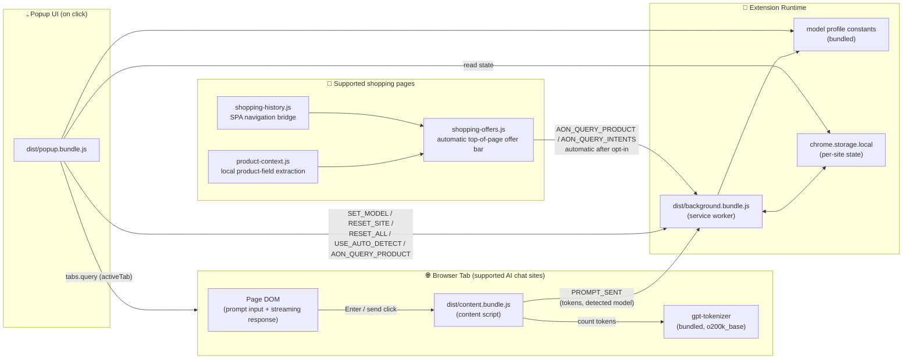

# AquaTrace  System Architecture

This document describes how AquaTrace's pieces fit together. For the water/energy/CO2 calculation methodology, see [methodology.html](./AquaTrace/methodology.html).

## High-level architecture



## Components

| Component | Role |

| **`dist/content.bundle.js`** (content script) | Injected into supported AI chat pages only. Detects when a prompt is submitted and when a response finishes streaming, counts tokens for both using the bundled tokenizer, scans the page for the currently selected model name, and sends the result to the background script. Never sends the actual conversation text anywhere only token counts. |
| **`dist/background.bundle.js`** (service worker) | The only long lived piece. Owns all persisted state in `chrome.storage.local`, keyed per site. Applies auto detected models unless the user has manually overridden that site's choice. Handles reset requests. |
| **`dist/popup.bundle.js`** (popup UI) | Runs only while the popup is open. Determines which site's card to show by querying the active tab, reads state from storage, renders AI metrics, and can show shopping offers. Sends messages to the background script for any state changes (model picks, resets) rather than writing storage directly. It also keeps the shopping opt-in toggle synchronized with the automatic in-page offer bar. |
| **`product-context.js`** (shopping content script) | Runs only on supported Amazon and Flipkart pages. It extracts only product title, category, price, and currency locally in response to `GET_PRODUCT_DATA`; the companion `shopping-offers.js` uses that context for automatic offers only after the one-time opt-in. |
| **`shopping-offers.js`** (shopping content script) | Injects the collapsible Shadow DOM offer bar, observes SPA navigation and page updates, and requests bounded sponsored offers without reading AI tracking data. |
| **Model profile constants** (bundled) | The current repository commits generated bundles rather than a shared source module, so profile values and detection rules are duplicated across the background, popup, and content bundles. Keep them synchronized or add a reproducible build source before changing model data. |
| **`chrome.storage.local`** | Local AI totals/history, shopping consent, and the daily AON query counter. No Chrome sync. |
| **`chrome.storage.session`** | Ten-minute query cache and per-tab dismissal/last non-empty offers; accessible only through the worker, cleared at browser-session end. |
| **AON Offer Query** | After one-time opt-in, the background allowlists product title, category, price, and currency, with cleaned shopping search keywords or generic text used when product context is missing. It sends no product URL, seller, page text, cookies, account data, AI text, token history, or tab metadata. Returned sponsored destinations are displayed as HTTPS links; a timeout or invalid response does not affect tracking. |

## Why this shape

- **AI tracking updates are serialized in the background.** The tracking content script sends counted tokens to the background worker rather than writing totals itself. The separate shopping script observes its opt-in setting and keeps tab UI state through the session-storage bridge.
- **Popup never runs in the background.** It only exists while open, so it always re derives "which site am I looking at" fresh from `chrome.tabs.query` rather than trying to stay in sync with a background process. The shopping offer bar is a separate content-script flow and continues working when the popup is closed.
- **Single source of truth is still a follow-up.** The generated bundles currently contain duplicated model configuration; changing a model's energy estimate or detection pattern requires updating each affected bundle consistently.

## Data flow for a single prompt (end to end)

1. User types in the chat page and hits Enter.
2. `dist/content.bundle.js` captures the prompt text, tokenizes it, and starts watching the page for the response.
3. Once the page goes quiet for 1.5s, `dist/content.bundle.js` tokenizes the response text and scans the page for the active model's name.
4. `dist/content.bundle.js` sends `PROMPT_SENT` (site, promptTokens, responseTokens, detectedModelId) to `dist/background.bundle.js`.
5. `dist/background.bundle.js` updates that site's entry in `chrome.storage.local` incrementing counts, and updating the model only if the user hasn't manually overridden it.
6. Next time the popup is opened, `dist/popup.bundle.js` reads that entry, applies the current model's Wh/token and the hosting company's WUE range, and renders the result.


# 💧 AquaTrace - AI Environmental Footprint Tracker

**Version 2.0.1**

AquaTrace is a browser extension that estimates the water, energy, and CO₂ footprint of your AI chat conversations across ChatGPT, Claude, Gemini, and DeepSeek.

## 🎯 Features

### Core Functionality
- **Real-time Token Tracking**: Counts tokens as you chat using GPT tokenizer
- **Multi-Platform Support**: Works with ChatGPT, Claude AI, Gemini, and DeepSeek
- **Independent Site Tracking**: Each AI service tracked separately with its own counters
- **Privacy-First Tracking**: Footprint calculations and conversation history stay local; shopping offers are separate and require a one-time opt-in
- **Shopping product matches**: After opt-in, Amazon.in, Amazon.com, and Flipkart pages automatically show up to three labeled sponsored offers in a top-of-page bar; the popup can show the current or latest offers too, using a bounded product snapshot, cleaned search keywords, or a generic starter request
- **Offer dismissal**: Dismissing the bar hides it for that page document only. It reappears after a refresh, on a new tab, in another tab, or after SPA navigation to a new page.
- **Company-Specific Estimates**: Uses accurate WUE (Water Usage Effectiveness) and carbon intensity data for each hosting provider

### Version 2.0.0 updates
- Reorganized the popup into Shopping and AI Footprints tabs, with Shopping as the default
- One-time opt-in automatic sponsored offers on supported Amazon and Flipkart pages
- Collapsible in-page Shadow DOM offer bar with session dismissal and HTTPS action links
- Product-context priority with cleaned URL-query and generic fallback retries
- Shows the latest non-empty sponsored suggestions in the popup outside shopping sites
- Keeps live product, search and starter suggestions on Amazon and Flipkart

### New in Version 1.1.0 ✨
- **DeepSeek Support**: Full tracking for DeepSeek V3 and DeepSeek R1 models
- **CSV Export**: Download complete usage history and environmental impact data
- **Enhanced Accuracy**: Updated energy estimates based on latest research
- **Improved UI**: Better dark mode support and visual polish

### Version 1.2.0 updates
- **Copy Summary**: Copy the selected site's token totals to the clipboard
- Serializes background storage updates so simultaneous prompts are not lost
- Captures streamed text updates made to existing response text nodes
- Uses site-specific assistant-response adapters to reduce UI and prompt-text contamination
- Shows the live model detected on the current AI chat page
- Stores up to 100 local conversation summaries and displays seven-day token trends

## 📊 Supported Models

| Model | Energy per Token | Tokenizer | Company/Host |
|-------|------------------|-----------|--------------|
| GPT-4o Mini | 0.0001 Wh | Exact | Microsoft Azure |
| GPT-4o | 0.0006 Wh | Exact | Microsoft Azure |
| GPT-5 | 0.0025 Wh | GPT-4o proxy | Microsoft Azure |
| Claude Sonnet | 0.0006 Wh | Approx | Amazon AWS |
| Claude Opus | 0.0018 Wh | Approx | Amazon AWS |
| Gemini Flash | 0.00012 Wh | Approx | Google Cloud |
| Gemini Pro | 0.0008 Wh | Approx | Google Cloud |
| DeepSeek V3 | 0.001 Wh | Approx | China Infrastructure |
| DeepSeek R1 | 0.0029 Wh | Approx | China Infrastructure |

## 🚀 Installation

1. Download or clone this repository
2. Open your Chrome/Edge browser
3. Navigate to `chrome://extensions/`
4. Enable "Developer mode"
5. Click "Load unpacked"
6. Select the extension folder

### Build, test and reload 2.0.1

The checkout does **not** include the original sources/bundler for `dist/*.bundle.js`.
The existing background and popup bundles were patched carefully; the AI-tracking
`dist/content.bundle.js` was left unchanged. New shopping and onboarding code is
plain JavaScript. There is no `npm install`/bundler step to pretend to rerun.

From the `AquaTrace/` extension folder (the one containing `manifest.json`), run:

```sh
node --test test/*.test.js
python3 build.py
```

Node 18+ and Python 3.8+ are required. The release command checks runtime JavaScript
syntax, manifest references, and regression tests, then creates a deterministic
`build/AquaTrace-2.0.1.zip` containing only explicitly allowlisted extension files.
It excludes private attachments, `.opencode`, local configuration, and test fixtures.

1. In `chrome://extensions`, click **Reload** on the existing unpacked AquaTrace,
   or use **Load unpacked** on this folder (or an extracted copy of the new ZIP).
   Do not remove your existing installation if you want to keep usage totals.
2. Refresh any already-open Amazon/Flipkart tabs so the new content scripts load.
3. The first install/upgrade opens `onboarding.html`. Its single checkbox is off.
   The automatic-offer consent is stored separately from the AI tracking data.
   Later extension reloads preserve the choice.
4. Tick **Show sponsored product suggestions while I shop on Amazon and Flipkart**.
   Leave the popup closed; available offers now follow home, search and product pages.
5. Turn the same checkbox off in the popup to remove all offer bars and stop requests.
   Dismissing the bar instead suppresses it for that tab until the tab is closed.

No live shopping/AON traffic is produced by the tests or build. The automated
acceptance fixtures use the real extension code with simulated Chrome/DOM/network
boundaries. They do not replace a real Chrome 114+ smoke test against current site
markup, live offer inventory, image loading, or actual new-tab clicks.

## 📖 How It Works

### Token Counting
Uses the `gpt-tokenizer` JavaScript library (OpenAI's BPE tokenizer) to count tokens in:
- Your prompts (input)
- AI responses (output)

### Environmental Calculations
1. **Tokens → Energy**: Multiplies token count by model-specific Wh/token
2. **Energy → Water**: Uses company-specific WUE ranges (liters per kWh)
3. **Energy → CO₂**: Uses grid carbon intensity (grams CO₂ per kWh)

### Company-Specific Data

**Water Usage Effectiveness (WUE):**
- Amazon AWS: 0.15 - 1.8 L/kWh
- Microsoft Azure: 0.30 - 1.52 L/kWh
- Google Cloud: 0.50 - 1.2 L/kWh
- China Infrastructure: 1.0 - 3.0 L/kWh

**Carbon Intensity:**
- AWS/Azure/Google: 445 g CO₂/kWh (global average)
- China: 555 g CO₂/kWh (China grid average)

## 📥 Export Feature

Click the "📥 Export Footprint Data" button to download a CSV containing:
- Site-by-site breakdown
- Model selections
- Prompt counts
- Token usage (input/output)
- Water consumption (low/high estimates)
- Energy consumption (Wh)
- CO₂ emissions (grams)

Perfect for:
- Personal record keeping
- Academic research
- Usage pattern analysis
- Carbon footprint reporting

## 🔒 Privacy

**Local footprint tracking:**
- No AI conversation text is transmitted by AquaTrace
- Footprint calculations, aggregate totals, and up to 100 local conversation summaries stay in browser storage
- No analytics are sent; optional shopping-offer requests begin only after opt-in

**Optional product offers:**
- The shopping content scripts read only product title, category, displayed price, and currency locally; they do not send them before opt-in
- After the user enables automatic matches once, supported shopping pages send those four product fields to AON's Offer Query endpoint without requiring a popup click for each page
- Without product context, only cleaned Amazon `k` / Flipkart `q` search keywords or the generic text `Show me relevant offers` are sent instead
- The request does not include the product URL, seller, page text, cookies, account data, AI conversation text, local history, token counts, or tab metadata
- As with any HTTPS request, normal connection metadata such as an IP address may be visible to AON; AquaTrace does not add a user ID, cookie, or account identifier
- Results are clearly labeled sponsored offers; the offer bar can be collapsed or dismissed for the current tab/session, and AquaTrace may earn a commission when a user chooses one
- If the request fails or times out, no offer data is shown and local tracking continues
- Identical queries (including empty results) are cached for ten minutes in extension session storage
- At most 50 attempts per UTC day per browser profile, including fallbacks and failures; the AON placement's separate network-wide allowance is 1,000 offers/day
- Opt-out aborts in-flight requests and blocks queued fallbacks; it cannot retract data already transmitted

Reset AI usage from the popup. Shopping consent and the quota are separate from
AI usage resets; uninstalling clears all extension storage.

### Public configuration and security

The live AON placement identifier in `aon-config.js` is intentionally public
client configuration. AquaTrace's live requests do **not** contain an API key,
password, bearer token, account credential, or private signing key. Do not add
one: anything bundled into a browser extension can be extracted by users.

The public placement ID can be copied by other clients and may be able to
consume the placement's shared AON quota or create noisy placement statistics.
It is not a user credential and does not grant access to AquaTrace's local AI
history. If stronger abuse protection is required, configure restrictions or
rate limits with AON, or move the AON request behind a server you control; do
not embed a secret in this repository or extension package.

The extension sends shopping data to AON only after the user enables the
automatic-suggestions checkbox. It sends only the bounded product fields or
cleaned search intent described above. See the [privacy policy](https://ayush60728.github.io/AquaTrace/)
and [methodology](./AquaTrace/methodology.html) for the complete disclosure.

### GitHub publishing hygiene

Private development attachments and release packages are already excluded from
Git by the root `.gitignore` and `AquaTrace/.gitignore`. The `.opencode/`
directory contains local development attachments and must not be published. The
release ZIP is a build output, not a source file, and must not be committed.

The current Web Store package is generated at
`AquaTrace/build/AquaTrace-2.0.1.zip`; it is ignored and should be uploaded to
the Web Store separately rather than committed by default.

Before committing, inspect the staged file list and scan for credentials:

```bash
git status --short
git diff --cached --stat
git grep -n -I -E 'Authorization|Bearer |apiKey|API_KEY|password|BEGIN .*PRIVATE KEY|sk-|AIza'
```

Never commit `.env` files, API keys, access tokens, passwords, private keys,
certificates, local logs, browser data, or chat/session attachments. If a
secret has already been pushed, rotate it immediately and remove it from Git
history; deleting it in a later commit is not sufficient.

## 🎨 Features

- **Dark Mode**: Automatic theme switching
- **Per-Site Metrics**: Track each AI service independently
- **Model Auto-Detection**: Automatically detects the model you're using
- **Manual Override**: Change model selection if auto-detection is wrong
- **Badge Counter**: Shows total prompt count in extension icon

## 📋 Methodology

All estimates are based on:
- Published research papers on AI inference energy
- Company sustainability reports
- Grid carbon intensity data from IEA
- Parameter count and architecture analysis

**Important**: These are modeled estimates, not precise measurements. Use them to understand relative impact and usage patterns, not as exact figures.

## 🛠️ Technical Details

**Built With:**
- Manifest V3
- Vanilla JavaScript
- Chrome Extension APIs
- GPT Tokenizer library

**File Structure:**
```
├── manifest.json          # Extension configuration
├── popup.html            # Popup UI
├── popup.css             # Styling
├── product-context.js    # Local Amazon/Flipkart product-field extractor
├── shopping-offers.js    # Opt-in in-page sponsored-offer experience
├── shopping-history.js   # MAIN-world SPA navigation notification bridge
├── shopping-session.js   # Worker bridge for tab/session dismissal and offer cache
├── onboarding.html/js/css # One-time consent page (no remote requests)
├── build.py              # Offline validation and allowlisted release packaging
├── methodology.html      # Documentation
├── dist/
│   ├── background.bundle.js   # Service worker
│   ├── content.bundle.js      # AI tracking content script
│   └── popup.bundle.js        # Popup logic
└── icons/               # Extension icons
```

## 📝 License

This project is provided as-is for educational and personal use.

## 🤝 Contributing

Contributions, issues, and feature requests are welcome! Key areas for improvement:
- Adding more AI platforms
- Improving energy estimates with new research
- Enhanced export formats (JSON, Excel)
- Visualization features
- Multi-language support

## 📞 Support

For issues, questions, or suggestions, please open an issue on the repository.

---

**AquaTrace** - Making AI's environmental impact visible, one token at a time. 💧🌍
