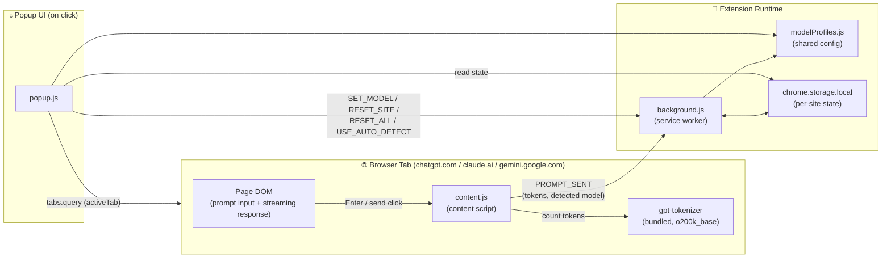

# AquaTrace  System Architecture

This document describes how AquaTrace's pieces fit together. For feature docs and setup instructions, For the water/energy/CO2 calculation methodology, see [methodology.html](./AquaTrace/methodology.html).

## High-level architecture



## Components

| Component | Role |

| **`content.js`** (content script) | Injected into supported AI chat pages only. Detects when a prompt is submitted and when a response finishes streaming, counts tokens for both using the bundled tokenizer, scans the page for the currently selected model name, and sends the result to the background script. Never sends the actual conversation text anywhere only token counts. |
| **`background.js`** (service worker) | The only long lived piece. Owns all persisted state in `chrome.storage.local`, keyed per site. Applies auto detected models unless the user has manually overridden that site's choice. Handles reset requests. |
| **`popup.js`** (popup UI) | Runs only while the popup is open. Determines which site's card to show by querying the active tab, reads state from storage, and renders it. Sends messages to the background script for any state changes (model picks, resets) rather than writing storage directly. |
| **`modelProfiles.js`** (shared config) | Not a running component a shared data module imported by `content.js`, `background.js`, and `popup.js` alike, so all three always agree on model energy values, percompany water efficiency ranges, and model detection keyword patterns. |
| **`chrome.storage.local`** | The only persistence layer. Never synced, never transmitted local to the browser profile. |

## Why this shape

- **Content script never talks to storage directly.** It only ever sends a message to the background script, which is the single source of truth for state. This avoids race conditions if multiple tabs on the same site are open at once.
- **Popup never runs in the background.** It only exists while open, so it always re derives "which site am I looking at" fresh from `chrome.tabs.query` rather than trying to stay in sync with a background process.
- **Shared config, not duplicated constants.** Because `modelProfiles.js` is imported by all three surfaces, an update to a model's energy estimate or detection pattern only needs to happen in one place.

## Data flow for a single prompt (end to end)

1. User types in the chat page and hits Enter.
2. `content.js` captures the prompt text, tokenizes it, and starts watching the page for the response.
3. Once the page goes quiet for 1.5s, `content.js` tokenizes the response text and scans the page for the active model's name.
4. `content.js` sends `PROMPT_SENT` (site, promptTokens, responseTokens, detectedModelId) to `background.js`.
5. `background.js` updates that site's entry in `chrome.storage.local` incrementing counts, and updating the model only if the user hasn't manually overridden it.
6. Next time the popup is opened, `popup.js` reads that entry, applies the current model's Wh/token and the hosting company's WUE range, and renders the result.


# 💧 AquaTrace - AI Environmental Footprint Tracker

**Version 1.1.0**

AquaTrace is a browser extension that estimates the water, energy, and CO₂ footprint of your AI chat conversations across ChatGPT, Claude, Gemini, and DeepSeek.

## 🎯 Features

### Core Functionality
- **Real-time Token Tracking**: Counts tokens as you chat using GPT tokenizer
- **Multi-Platform Support**: Works with ChatGPT, Claude AI, Gemini, and DeepSeek
- **Independent Site Tracking**: Each AI service tracked separately with its own counters
- **Privacy-First**: All calculations happen locally - no data ever leaves your browser
- **Company-Specific Estimates**: Uses accurate WUE (Water Usage Effectiveness) and carbon intensity data for each hosting provider

### New in Version 1.1.0 ✨
- **DeepSeek Support**: Full tracking for DeepSeek V3 and DeepSeek R1 models
- **CSV Export**: Download complete usage history and environmental impact data
- **Enhanced Accuracy**: Updated energy estimates based on latest research
- **Improved UI**: Better dark mode support and visual polish

## 📊 Supported Models

| Model | Energy per Token | Tokenizer | Company/Host |
|-------|------------------|-----------|--------------|
| GPT-4o Mini | 0.0001 Wh | Exact | Microsoft Azure |
| GPT-4o | 0.0006 Wh | Exact | Microsoft Azure |
| GPT-5 | 0.0025 Wh | Exact | Microsoft Azure |
| Claude Sonnet | 0.0006 Wh | Approx | Amazon AWS |
| Claude Opus | 0.0018 Wh | Approx | Amazon AWS |
| Gemini Flash | 0.00012 Wh | Approx | Google Cloud |
| Gemini Pro | 0.0008 Wh | Approx | Google Cloud |
| DeepSeek V3 | 0.001 Wh | Approx | China Infrastructure |
| DeepSeek R1 | 0.0029 Wh | Approx | China Infrastructure |

## 🚀 Installation

1. Download or clone this repository
2. Open your Chrome/Edge browser
3. Navigate to `chrome://extensions/`
4. Enable "Developer mode"
5. Click "Load unpacked"
6. Select the extension folder

## 📖 How It Works

### Token Counting
Uses the `gpt-tokenizer` JavaScript library (OpenAI's BPE tokenizer) to count tokens in:
- Your prompts (input)
- AI responses (output)

### Environmental Calculations
1. **Tokens → Energy**: Multiplies token count by model-specific Wh/token
2. **Energy → Water**: Uses company-specific WUE ranges (liters per kWh)
3. **Energy → CO₂**: Uses grid carbon intensity (grams CO₂ per kWh)

### Company-Specific Data

**Water Usage Effectiveness (WUE):**
- Amazon AWS: 0.15 - 1.8 L/kWh
- Microsoft Azure: 0.30 - 1.52 L/kWh
- Google Cloud: 0.50 - 1.2 L/kWh
- China Infrastructure: 1.0 - 3.0 L/kWh

**Carbon Intensity:**
- AWS/Azure/Google: 445 g CO₂/kWh (global average)
- China: 555 g CO₂/kWh (China grid average)

## 📥 Export Feature

Click the "📥 Export Footprint Data" button to download a CSV containing:
- Site-by-site breakdown
- Model selections
- Prompt counts
- Token usage (input/output)
- Water consumption (low/high estimates)
- Energy consumption (Wh)
- CO₂ emissions (grams)

Perfect for:
- Personal record keeping
- Academic research
- Usage pattern analysis
- Carbon footprint reporting

## 🔒 Privacy

**100% Local Processing:**
- No network requests
- No data collection
- No third-party services
- No conversation text transmitted
- Data stored only in browser's local storage

Clear your data anytime by clicking "Reset All Sites" or uninstalling the extension.

## 🎨 Features

- **Dark Mode**: Automatic theme switching
- **Per-Site Metrics**: Track each AI service independently
- **Model Auto-Detection**: Automatically detects the model you're using
- **Manual Override**: Change model selection if auto-detection is wrong
- **Badge Counter**: Shows total prompt count in extension icon

## 📋 Methodology

All estimates are based on:
- Published research papers on AI inference energy
- Company sustainability reports
- Grid carbon intensity data from IEA
- Parameter count and architecture analysis

**Important**: These are modeled estimates, not precise measurements. Use them to understand relative impact and usage patterns, not as exact figures.

## 🛠️ Technical Details

**Built With:**
- Manifest V3
- Vanilla JavaScript
- Chrome Extension APIs
- GPT Tokenizer library

**File Structure:**
```
├── manifest.json          # Extension configuration
├── popup.html            # Popup UI
├── popup.css             # Styling
├── methodology.html      # Documentation
├── dist/
│   ├── background.bundle.js   # Service worker
│   ├── content.bundle.js      # Content script
│   └── popup.bundle.js        # Popup logic
└── icons/               # Extension icons
```

## 📝 License

This project is provided as-is for educational and personal use.

## 🤝 Contributing

Contributions, issues, and feature requests are welcome! Key areas for improvement:
- Adding more AI platforms
- Improving energy estimates with new research
- Enhanced export formats (JSON, Excel)
- Visualization features
- Multi-language support

## 📞 Support

For issues, questions, or suggestions, please open an issue on the repository.

---

**AquaTrace** - Making AI's environmental impact visible, one token at a time. 💧🌍
